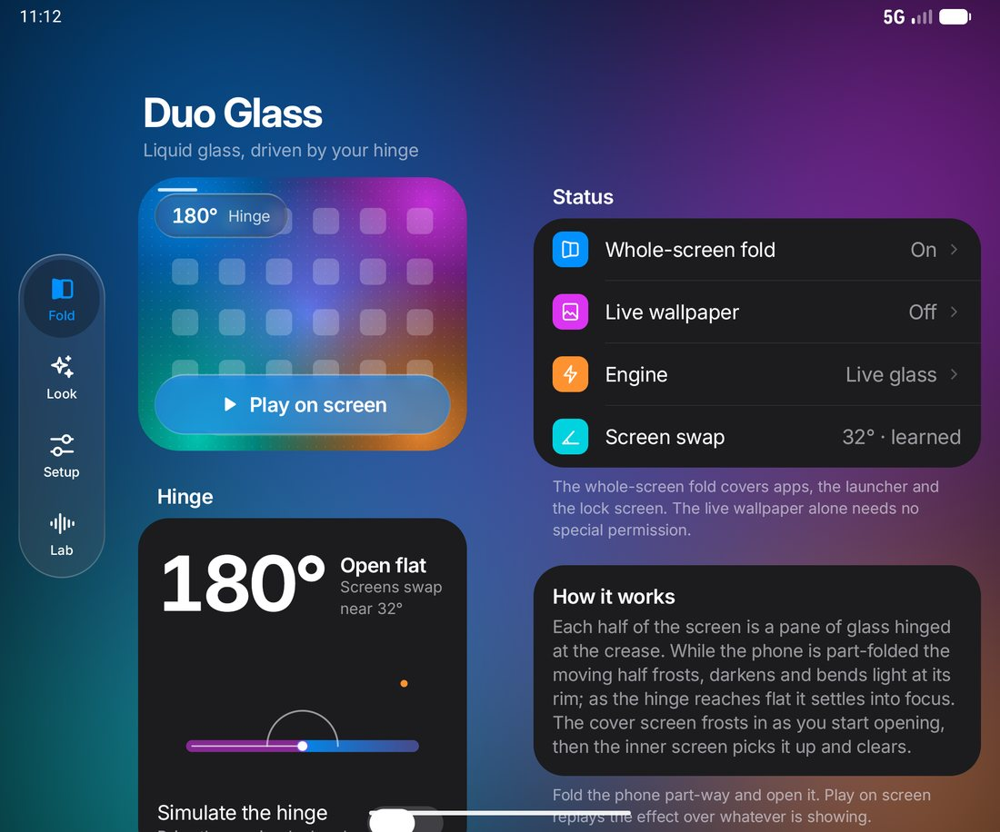
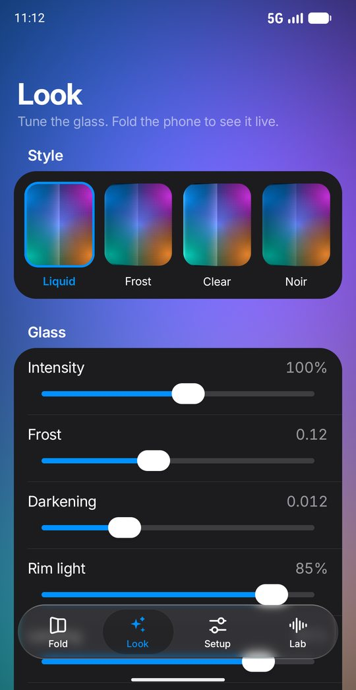
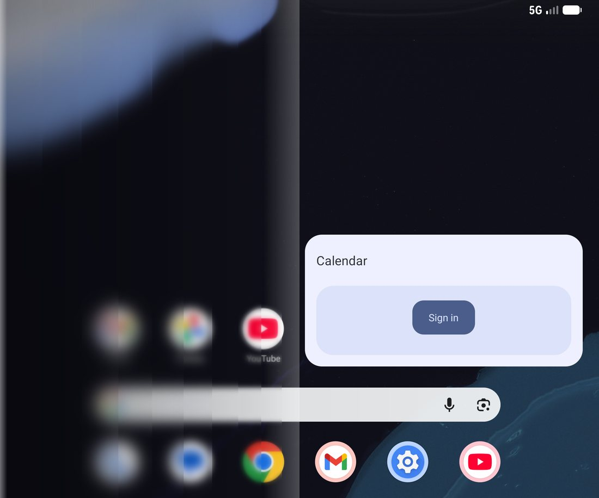

# Duo Glass

A ground-up rebuild of [Duo Open](https://github.com/marcoazeem/duo-open): the
iPhone "Duo" glass fold, playing system-wide on a book-style foldable as you
open and close it, driven by the real hinge angle. No root.

This fork is tuned for the **original Pixel Fold on Android 17** and wrapped in
an app that follows **iOS 27's design language** — Liquid Glass controls,
large titles, inset grouped lists, a floating capsule tab bar, and iOS 27's
"iPhone Duo" two-pane layout with a vertical tab bar when the phone is open.

| Inner screen | Cover screen | Live glass on the home screen |
|---|---|---|
|  |  |  |

## What changed from Duo Open

**The fold engine (works properly on Pixel Fold now)**

- **Crease orientation is right on the Pixel Fold.** Upstream decided the
  fold's axis from "does the crease split the long or short side", defaulting
  to *short* (true on the OnePlus Open). The Pixel Fold's inner panel is
  natively landscape (2208×1840) with the crease splitting the *long* side, so
  the frost was drawn across the wrong axis. Duo Glass uses the fact that every
  book-style foldable has its crease vertical in the inner panel's natural
  orientation, maps it through the display rotation, and confirms it from
  Jetpack WindowManager — learned inside the service, so you don't need to open
  the app unfolded first. There's still a manual override.
- **Live glass actually blurs as a gradient.** Upstream's live mode used
  `FLAG_BLUR_BEHIND` strip windows. WindowManager implements that with *one
  display-wide dim layer* that takes a single radius from the topmost blurring
  window, so the "gradient" collapsed to one uniform blur over the whole screen
  (the still half included). Duo Glass uses per-window *background* blur on
  nested strip windows, each adding only the blur the inner ones haven't, so the
  frost grows smoothly away from the crease and the other half stays sharp.
  Radius changes are SurfaceControl transactions, not WindowManager relayouts.
- **Instant start.** The live-glass windows are created once per display and
  kept hidden between folds (they survive the Pixel Fold's display-0 blink at
  the panel swap), so the glass appears in a few ms instead of ~0.4 s.
- **Android 17 overlay token fix.** On Android 17 a window context made from a
  display context no longer carries the accessibility service's window token
  (`BadTokenException: token null`); the default display now uses the
  service's own WindowManager.
- **Learns your phone.** The hinge angle at which the screens swap is learned
  from real opens (it varies per phone and per speed), so the cover always
  reaches full frost as it switches off and the inner screen always starts from
  full frost.
- **Never freezes over the screen.** A critically damped spring tracks the
  hinge; whenever the hinge goes quiet (tent mode, or a hinge HAL that stops
  reporting during a close) the glass eases out on its own and replays if you
  move again.
- **Liquid Glass shader.** The Snapshot engine's AGSL shader keeps the
  original's physical model (a pane rotating about the hinge, blur ∝ gap,
  perspective) and adds rim lensing, vibrancy and a static iOS 27 edge light.
- **Lab screen.** Live hinge/tilt graph, every engine event, and a one-tap
  report for bug reports.

**The app (iOS 27 design)** — see [docs/DESIGN.md](docs/DESIGN.md)

- A real Liquid Glass renderer for Compose: backdrop capture into a
  GraphicsLayer, blur, an AGSL lens pass (SDF rim refraction, slight chromatic
  dispersion, vibrancy), crisp hairline borders and static top/bottom edge light.
- iOS 27's **Liquid Glass slider** (Ultra Clear ↔ Fully Tinted) for the app's
  own glass.
- Large titles that collapse into a glass top bar with the iOS 27 "hard" scroll
  edge; floating capsule tab bar that minimizes on scroll; vertical glass tab
  bar and crease-aware two panes on the inner screen.
- iOS-style switch, slider (thumb turns to glass while dragged), segmented
  control with a springy pill, inset grouped sections, SF-Symbols-style icons,
  haptics, light and dark.

## Install

1. Get `app-release.apk` from the Actions run / Releases, or build it (below).
2. Install it. Then **Setup → Open Accessibility settings** and turn on
   *Duo Glass whole-screen fold*.
   - Android blocks Accessibility for sideloaded apps until allowed: tap the
     greyed toggle once, then *Settings → Apps → Duo Glass → ⋮ → Allow restricted
     settings*. **Setup → Toggle greyed out?** walks through it.
   - Or over USB, which skips the check:
     `adb install -r app-release.apk` then
     `adb shell settings put secure enabled_accessibility_services com.duoglass/com.duoglass.overlay.FoldService`
3. Fold the phone part-way and open it. **Play on screen** replays the effect.

Wallpaper-only mode needs no accessibility: **Setup → Set live wallpaper**.

The app id is `com.duoglass`, so it installs alongside upstream Duo Open.

## Engines

- **Live glass** (default where the system allows window blur — Pixel Fold
  does): the system blur over the *live* screen. Instant, nothing captured,
  content keeps moving. No perspective bend. Battery saver can turn window blur
  off; the app then falls back to Snapshot.
- **Snapshot**: one screenshot per fold phase bent through the shader:
  perspective, smooth frost, rim lensing. Frozen while it plays, and a screen
  that has just lit up takes ~0.3 s to capture (bridged with its last picture).

## Privacy

No internet permission. The Snapshot engine screenshots the display only while
a fold plays and keeps it in memory; Live glass captures nothing. Secure
screens (banking, DRM) can't be captured and simply don't get the Snapshot
effect.

## Build

Requires JDK 17 and the Android SDK with platform 37.

```
./gradlew assembleDebug        # debug build
./gradlew assembleRelease      # minified; signed with keystore.properties if present, else the debug key
./gradlew testDebugUnitTest    # geometry + fold-model tests
```

Release signing reads `keystore.properties` in the project root (`storeFile`,
`storePassword`, `keyAlias`, `keyPassword`).

Handy adb: `adb shell am broadcast -a com.duoglass.DEMO` replays the effect,
`--el hold 3000` holds full frost first; `adb logcat -s GlassFold` shows every
engine event. On the emulator, `adb emu sensor set hinge-angle0 <deg>` drives
the hinge (the `pixel_fold` AVD swaps panels like the real phone).

## Layout

```
app/src/main/res/raw/fold_glass.agsl        fold shader (pane tilt, perspective, rim lensing, edge light)
core/hinge/HingeSensor.kt                   one shared hinge registration (sensor picker, coarse detection)
core/fold/FoldGeometry.kt                   rotation-aware crease placement, inner/cover panel detection
core/fold/FoldModel.kt                      hinge angle → pane tilt, learned swap angle
core/fold/SpringFollower.kt                 critically damped per-vsync spring
core/settings/GlassSettings.kt              settings + learned values
overlay/FoldService.kt                      accessibility service: one director per lit display
overlay/PanelDirector.kt                    per-display state machine (track, ease, capture, demo)
overlay/surface/LiveGlassSurface.kt         pre-warmed nested background-blur windows + sheen
overlay/surface/SnapshotSurface.kt          screenshot through the shader at half resolution
wallpaper/                                  live wallpaper engine and picture
ui/glass/LiquidGlass.kt                     Liquid Glass for Compose (backdrop, blur, AGSL lens, rim)
ui/theme, ui/components                     iOS 27 tokens, type, controls, tab bars, sheets, symbols
ui/screens                                  Fold, Look, Setup, Lab
```

Not carried over from upstream (yet): Shizuku mode (Samsung continuous angle,
shell capture) and the separate "lite" flavor.

## Credits

- **[marcoazeem/duo-open](https://github.com/marcoazeem/duo-open)** (MIT) — the
  app this is rebuilt from, including its fold model and hard-won device notes.
- **[Atomicx7/Duo-animation](https://github.com/Atomicx7/Duo-animation)** — the
  frosted-glass fold shader the whole idea started from.
- **[Inter](https://rsms.me/inter/)** (OFL) — the typeface standing in for SF Pro.

See [THIRD_PARTY_NOTICES.md](THIRD_PARTY_NOTICES.md). Not affiliated with
Apple; "iOS" and "Liquid Glass" are Apple's.

## License

MIT — see [LICENSE](LICENSE).
